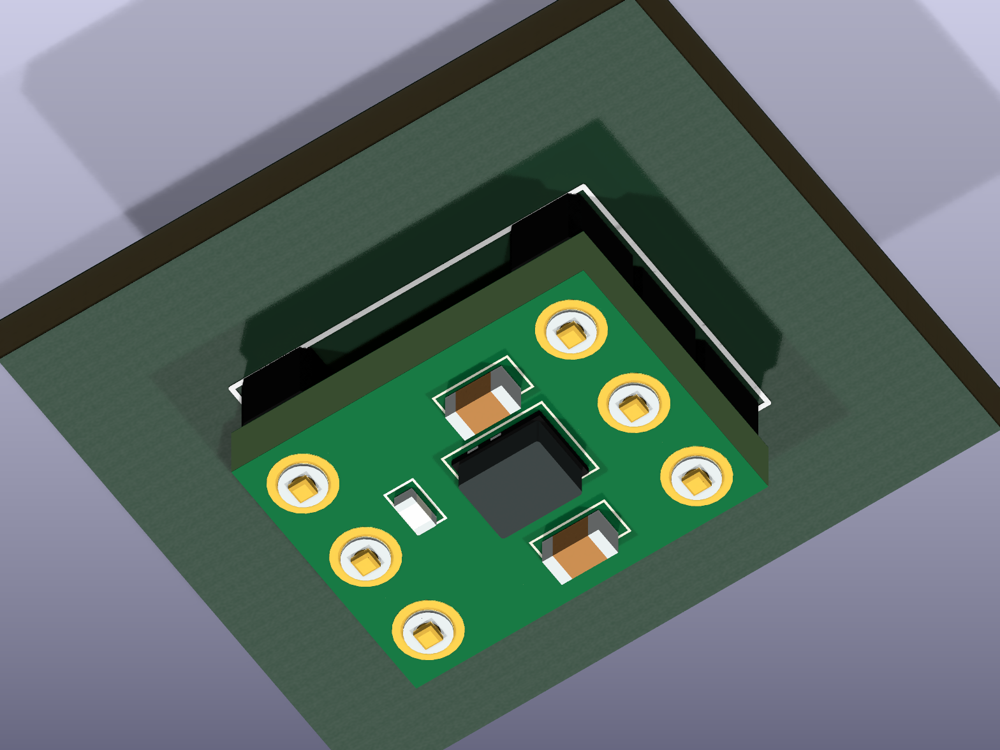
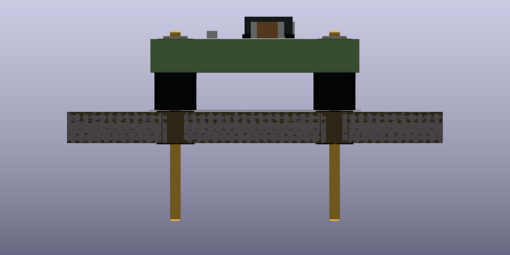

# AE-XCL103-3V3（秋月 116116）

## 登録内容

- シンボル: `micro_keyboard:AE-XCL103-3V3`
- フットプリント: `micro_keyboard:AE-XCL103-3V3_Horizontal`
- 実装: 部品面を上にした平置き。付属PHA-1x9SGを3極ずつ2列に切断し直付け。ソケットなし。
- 3D: `hardware/kicad/lib/3d_models/AE-XCL103-3V3_Horizontal.step`
- 寸法パラメータと再生成スクリプト: 同フォルダーの`source/`

## ピン対応

メーカー資料はモジュール端子に番号を付けていないため、このライブラリでは部品面から見てDIPと同じ反時計回りの番号を定義した。裏面のシルクをそのまま部品面へ転記すると左右が反転するため、公式正面・裏面写真と回路図を照合した。

```text
部品面から見た上面図（mm、原点は端子格子の中心）

               10.0
      ┌───────────────────┐
GND 1 │ ●               ● │ 6 IN（主電源入力）
 EN 2 │ ●               ● │ 5 GND
 IN 3 │ ●               ● │ 4 OUT（3.3V）
      └───────────────────┘
         ←── 7.62 ──→
      各列のピッチ2.54 / 基板高さ7.5
```

| Pad | シンボル端子 | X | Y（KiCad上面図） | 用途 |
|---|---|---:|---:|---|
| 1 | GND | -3.81 | -2.54 | GND |
| 2 | EN | -3.81 | 0 | 出力制御。モジュール内100kΩでINへプルアップ |
| 3 | IN_AUX | -3.81 | 2.54 | 内部でINにつながる補助端子。配線が細いため主電源入力には使わない |
| 4 | OUT_3V3 | 3.81 | 2.54 | 昇圧出力 |
| 5 | GND | 3.81 | 0 | GND |
| 6 | IN | 3.81 | -2.54 | 主電源入力 |

IN_AUXとIN、およびGND同士はモジュール内で接続されている。KiCadはモジュール内部接続を自動で外部配線として扱わないため、親基板の電源には6番、GNDには1番または5番を使用する。EN未使用時は未接続マークを付ける。3番を未使用とする場合も未接続マークを付ける。

## 機械寸法と根拠

| 対象 | モデル寸法（mm） | 根拠 |
|---|---|---|
| モジュール基板 | 10 × 7.5 × 1.6 | 外形は公式説明書。厚さはユーザー指定（2026-10-19） |
| 端子中心 | 2.54ピッチ、列間7.62 | 公式説明書。基板左端から1.19、上端から1.21 |
| 親基板のランド | φ1.8、穴φ0.8 | φ0.8は付属ヘッダ推奨穴径。ランド径は本設計の選択 |
| ヘッダ樹脂 | 幅2.0、高さ1.8 | PHA-1x9SG図面の公称値 |
| ヘッダピン | 0.5角、樹脂上2.0、樹脂下5.3 | PHA-1x9SG図面。親基板側のピンは切断前の長さ |
| XCL103D333CR-G | 2.5 × 2.0 × 1.04 | TOREX CL-2025-02外形寸法（インダクタ内蔵） |
| C1 / C2 | 1.6 × 0.8 × 0.8 | Murata GRM188R6YA106MA73、1608/0603、公称値。各辺±0.2 |
| R1 | 1.0 × 0.5 × 0.35 | KOA RK73B1E、1005/0402、公称値 |

Z=0は親基板の部品面。ヘッダ樹脂を親基板に着座させ、モジュール基板下面をZ=1.8、上面をZ=3.4に配置した。SMD部品には視覚表現用の0.04 mmのはんだ隙間を置いており、モデル上の最高点はZ=4.48。これは公称寸法モデルの高さで、製造公差を含めた最大保証寸法ではない。

搭載位置は秋月の部品面正面写真を端子中心格子で縮尺合わせして復元した概略位置。メーカーの実装座標ではない。IC内部のインダクタ・下部ICの分割、端子・はんだ形状、シルクは外観表現。基板内の銅配線と小径ビアは機械的干渉確認に使わないためモデル化していない。

## 部品表

購入用BOMには`AE-XCL103-3V3`を1セットとして載せる。実装済みのU1/C1/C2/R1と付属ヘッダを別途重複購入しない。上の搭載部品表は3D寸法の出典であり、親基板の購入用BOMではない。

## 出典

- [秋月 商品ページ・販売コード116116](https://akizukidenshi.com/catalog/g/g116116/)
- [秋月 説明書 2025-07-21](https://akizukidenshi.com/goodsaffix/AE-XCL103-3V3_20250721.pdf)
- [秋月 部品面の正面写真](https://akizukidenshi.com/img/goods/3/116116.jpg)
- [秋月 裏面の正面写真](https://akizukidenshi.com/img/goods/2/116116.jpg)
- [付属直ピンヘッダ寸法図](https://akizukidenshi.com/goodsaffix/A295-PHA-1xXXSG.pdf)
- [TOREX XCL103・CL-2025-02](https://product.torexsemi.com/en/series/xcl103)
- [Murata GRM188R6YA106MA73寸法資料](https://search.murata.co.jp/Ceramy/image/img/A01X/G101/ENG/GRM188R6YA106MA73-01A.pdf)
- [KOA RK73B寸法資料](https://www.koaspeer.com/pdfs/RK73B.pdf)

秋月の説明書はコンデンサの温度特性をX7Rと記載しているが、同じ型番のMurata資料ではX5R。3Dモデルは型番に対応するメーカーの外形寸法を使用した。

## 再生成

Python環境に`cadquery==2.8.0`を導入し、次を実行する。

```sh
python hardware/kicad/lib/3d_models/source/ae_xcl103_3v3_horizontal.py
```

フットプリントとライブラリテーブルは`${KIPRJMOD}`相対参照にしているため、リポジトリを別のPCへ移しても登録内容が維持される。

## 表示確認

KiCad 10.0.7でシンボルとフットプリントを読み込み、6端子の座標・穴径・STEP相対参照を照合した。STEPをOpenCascadeで再読み込みして61個のソリッドが有効であること、および搭載部品の外形が上記公称寸法と一致することを確認した。

以下は表示確認用の一時的な親基板上でレンダリングした画像。プロジェクト本体の基板外形・配線はまだ未確定。




