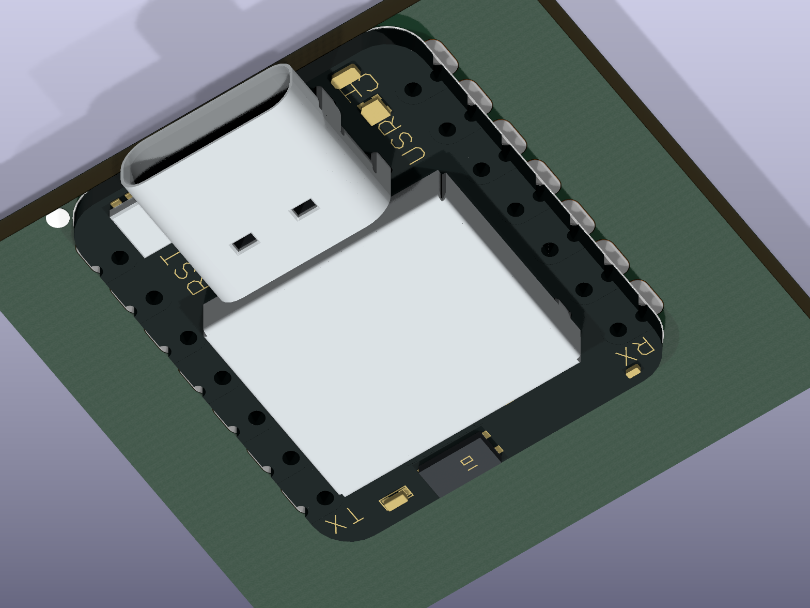

# XIAO nRF52840（通常版・表面実装）

## 登録

- Seeed Studio XIAO nRF52840、品番 **102010448**。Sense／Plus用ではありません。
- シンボル／フットプリント: `micro_keyboard:XIAO-nRF52840-SMD`
- 実装: ピンなし、部品面を上にして親基板に直接表面実装。
- 回路図とPCB: U2。部品登録段階の仮配置で、配線、製造用基板外形、RF領域設計は未実施。
- STEP: `${KIPRJMOD}/lib/3d_models/XIAO-nRF52840-SMD.step`
- ライブラリとSTEPはリポジトリ内に格納しているため、個人用環境変数は不要。

## 端子

Seeed公式SMDライブラリの22端子番号とランド座標を保持しています。座標は部品面から見たフットプリント座標です。左上が1、右上が14、USBが上です。側面のピッチは2.54 mm、左右ランド中心間は16.165 mm（基板本体の穴中心間とは異なる）。親基板側の側面ランドは2.75 × 2.0 mmです。

| 番号 | 信号 | MCUポート／役割 |
|---|---|---|
| 1 | D0 | P0.02 |
| 2 | D1 | P0.03 |
| 3 | D2 | P0.28 |
| 4 | D3 | P0.29 |
| 5 | D4 | P0.04 / SDA |
| 6 | D5 | P0.05 / SCL |
| 7 | D6 | P1.11 / TX |
| 8 | D7 | P1.12 / RX |
| 9 | D8 | P1.13 / SCK |
| 10 | D9 | P1.14 / MISO |
| 11 | D10 | P1.15 / MOSI |
| 12 | 3V3_OUT | 基板上レギュレーター出力 |
| 13 | GND | GND |
| 14 | VBUS | USB 5Vと共通 |
| 15 | SWDIO | 裏面デバッグ端子 |
| 16 | SWCLK | 裏面デバッグ端子 |
| 17 | RESET | 裏面リセット端子 |
| 18 | GND | 裏面GND |
| 19 | VBAT | 裏面BAT+、内蔵充電ICに接続 |
| 20 | GND | 裏面BAT− |
| 21 | NFC1 | P0.09 |
| 22 | NFC2 | P0.10 |

公式シンボルの17番は「EN」となっていますが、通常版の端子資料に合わせ「RESET」に修正しました。GPIO、SWD、電源端子の電気種別も設定しました。VBUSとVBATは入出力双方があり得るためpassiveを維持しています。

単4乾電池を充電しない要件があります。**VBATは充電回路につながるため乾電池を直結しません。** VBUSはUSB側と共通です。昇圧出力とXIAOの接続先、USBからの逆流防止は次の電源回路設計で確定します。現時点ではU1とU2を接続していません。

## 3Dモデル

公式WikiのSense用STEP（内部名称 `XIAO-nRF52840 v15.step`、2023-06-02）を元にしています。通常版と外観が異なるマイク `MSM261D3526H1CPM` の本体・細部・6接点（元STEPのsolid 76〜83）を取り除き、座標系を変換しました。シールド内部のICは元モデルにも表現されていません。色は表示用に再設定しており、写真の文字・印刷は含みません。

- 元STEPの基板外形: 約20.955 × 17.780 mm。USBを含む長さは約22.482 mm。
- 元STEPの基板厚: 約1.25 mm。昇圧モジュールの指定1.6 mmとは独立です。
- モデル全高: 約4.46 mm。裏面を親基板上面のZ=0に配置しています。
- モデルの拡大縮小は行っていません。フットプリント側のscale=1、offset=0、rotate=0。
- 2023年のメーカーCADに基づく外形モデルです。現行品の製造公差、はんだ厚、筐体クリアランスの保証値ではありません。公式ランドとモデル細部には約0.1 mmの差があります。電気接続ランドは公式フットプリントを優先しています。
- アンテナ周辺の銅箔・配線・金属筐体の配置禁止領域は、親基板の設計時に確定します。



画像の緑の板は表示専用の一時的な親基板です。プロジェクト本体にはこの外形を追加していません。

### 再生成

Python 3.12 / `cadquery==2.8.0`を使用します。公式3D ZIPを展開したSTEPを入力して、以下を実行します。

```sh
python hardware/kicad/lib/3d_models/source/adapt_xiao_model.py \
  'XIAO-nRF52840 v15.step' \
  hardware/kicad/lib/3d_models/XIAO-nRF52840-SMD.step
```

入力STEPのSHA-256、変換と削除部品の記録は、STEPと同名のJSONにあります。配布ZIPのURLとSHA-256は `xiao_sources.json` に記録しています。

## 出典・変更・ライセンス

作者: Seeed Studio。公式ライブラリから必要なシンボルとフットプリントを取り込みました。

- [公式Wiki・通常版のピン表と資料](https://wiki.seeedstudio.com/XIAO_BLE/)
- [公式シンボルZIP](https://files.seeedstudio.com/wiki/XIAO-KiCad-Library/XIAO_Series_SCH_Symbols.zip)
- [公式フットプリントZIP](https://files.seeedstudio.com/wiki/XIAO-KiCad-Library/New_XIAO_Series_Footprints.zip)
- [公式裏面端子資料](https://files.seeedstudio.com/wiki/XIAO-BLE/Bottom-pad-positioning.zip)
- [公式寸法DXF](https://files.seeedstudio.com/wiki/XIAO-BLE/XIAO-nRF52840-DXF.zip)
- [公式Sense用3DモデルZIP](https://files.seeedstudio.com/wiki/XIAO-BLE/seeed-studio-xiao-nrf52840-3d-model.zip)
- [Seeed公式OPL KiCadライブラリ](https://github.com/Seeed-Studio/OPL_Kicad_Library/tree/b0035c51eb0348bb3e165fdb2f2765fa3d1d17bd)

OPLライブラリはCC BY-SA 4.0。取り込んだXIAOシンボル・フットプリントとその改変部分にもCC BY-SA 4.0を適用します。ライセンス原文は `docs/licenses/seeed_opl_cc_by_sa_4.0.txt`。本リポジトリ全体のライセンスを変更するものではありません。

変更内容: Footprint参照をプロジェクト内に変更、品番・出典・実装方式を追記、17番の名称と電気種別を修正、Ref/Value位置を調整。フットプリントの既存ランドを保ち、SMD属性、コートヤード、ローカルSTEP参照を追加。

3D ZIPには独立したライセンス表示がありません。メーカー公式配布を出典とし、OPLのライセンスを3D ZIPにも適用できると断定していません。元ファイルは上記公式URLから取得できます。
